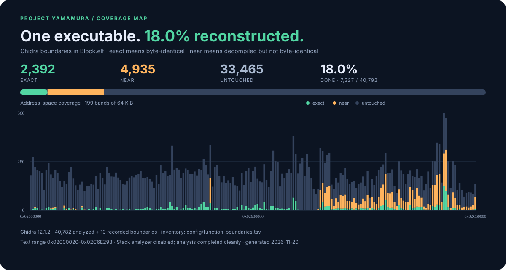

# Project Yamamura

A research decompilation of **Super Mario Maker** for Wii U, reconstructing C
from a legally obtained copy to study the engine's structure. The target is
`Block.elf`, the game's main executable (`00050000-1018DC00`, USA, v16).

Not affiliated with Nintendo. No game data, encryption key, SDK, compiler, or
playable build is included. See [`docs/PROVENANCE.md`](docs/PROVENANCE.md).

## Current status

| Metric | Current |
|:---|:---|
| **Target** | `Block.elf` (20,927,360 B, PowerPC big-endian) |
| **Direct `bl` starts** | 27,267 |
| **Ghidra boundaries** | 40,792 (40,782 analyzed + 10 recorded) |
| **Byte-identical functions** | 2,360 |
| **Archived near misses** | 4,937 rows (4,935 unique starts) |
| **Verified bytes** | 108,232 |
| **Coverage by `bl` starts** | 7,297 / 27,267 (**26.8%**) |
| **Coverage by Ghidra boundary** | 7,295 / 40,792 (**17.9%**) |

| Detail | Current |
|:---|:---|
| **Entry point** | `0x02B8AECC` (`_start`) — see [`docs/BOOTSTRAP.md`](docs/BOOTSTRAP.md) |
| **Bootstrap subsystem** | 5 runtime functions mapped; 4 byte-identical; `__init` remains a near miss |
| **Import calls resolved** | 8,704 call sites across 594 SDK entry points |
| **Named import evidence** | 7 call sites in 5 matched functions |
| **String evidence** | 1 code-related literal in 1 matched function |
| **Named symbols** | 64 in [`config/symbols.txt`](config/symbols.txt) |
| **Proposed role aliases** | 364 in [`config/function_names.tsv`](config/function_names.tsv) |
| **Toolchain** | GHS `ccppc` 5.3.27; per-row optimisation flags in [`src/functions.tsv`](src/functions.tsv) |

## Progress

[](docs/progress.svg)

The chart uses Ghidra's function manager, so its denominator is larger than the
27,267 direct `bl`-target starts. It includes pointer-reached functions, thunks,
and cold blocks. The archive index has 4,937 rows; the inventory and graph use
4,935 unique near starts after dropping duplicate and non-address records.

The final headless run disabled the `Stack` analyzer, completed in 810 seconds
without hitting the analysis cap, and produced the same 40,782 starts as the
earlier export. Ten boundaries Ghidra did not split are retained explicitly:
five verified exact starts and five direct `bl` targets.

- [Interactive coverage graph](docs/progress.html) — download and open locally
- [Function-boundary inventory](config/function_boundaries.tsv)
- [Boundary audit](docs/BOUNDARY_AUDIT.md) — `bl`-target and tiny-function checks
- [Decompilation log](docs/DECOMPILATION.md) — pass-by-pass notes

## Repository map

| Path | Contents |
|:---|:---|
| `include/` | Reconstructed headers, currently `block.h` with shared scalar types |
| `src/` | Matched C, one function per file; non-matching candidates in [`src/near/`](src/near/) |
| `config/` | Symbols, section splits, layout tables, the boundary inventory, and evidence inventories |
| `docs/` | Extraction pipeline, bootstrap map, decompilation notes, provenance, roadmap, progress graph, and analysis references |
| `tools/` | Import indexing, Ghidra scripts, m2c slicing, candidate matching, progress generation, and RPX extraction |

The generated [function-name catalog](docs/FUNCTION_NAMES.md),
[source-grouping candidates](docs/FUNCTION_GROUPS.md), and
[human-readability guide](docs/HUMAN_READABLE.md) are proposals. They never
rename a verified symbol or move a matched row without a new byte check.

Named SDK evidence is reported in
[`config/function_imports.tsv`](config/function_imports.tsv); exact-start
code-related strings are in
[`config/function_strings.tsv`](config/function_strings.tsv). Raw `asm/` stays
gitignored: disassembly dumps, rodata dumps, game assets, and unrelated
game-facing text do not belong in history.

## Tooling

| Tool | Purpose |
|:---|:---|
| `tools/import_index.py` | Build `imports_by_name.tsv` and `import_calls.tsv` from `.rela.text` |
| `tools/rtti_index.py` | Build `config/rtti_classes.tsv` from the local middleware string dump |
| `tools/rpx_extract.py` | Decompress a local Wii U RPX/RPL into an ignored ELF-like file for layout and relocation analysis |
| `tools/LabelImports.java` | Ghidra script: create import stubs and name all 594 imports |
| `tools/ExportFunctionBoundaries.java` | Ghidra headless script: export every analyzed `.text` function with its entry point and body range |
| `tools/DisableHeavyAnalyzers.java` | Ghidra pre-analysis script: disable the `Stack` analyzer while preserving function discovery |
| `tools/audit_boundaries.py` | Cross-check the export against direct `bl` targets and sampled tiny-function instructions |
| `tools/build_progress.py` | Merge exact/near statuses and missing `bl` targets into the inventory; regenerate the HTML/SVG graph |
| `tools/fn2m2c.py` | Slice one function out of `main.s` into m2c-parsable assembly |
| `tools/match.py` | Compile a source file with GHS `ccppc`, apply relocations and optional per-row flags, and diff it word for word |
| `tools/crack.py` | Generate an m2c candidate, compile it, apply relocations, and show an instruction-aligned diff |
| `tools/batch.py` | Find eligible leaves or direct-call functions in a band and log results to `build/batch/results.tsv` |
| `tools/analyze_structure.py` | Emit role aliases, evidence tables, source-grouping candidates, and readability docs |

`tools/ghidra_label_imports.py` is the Jython twin of the Java labeler, kept for
reference; the Java script is the one that runs.

## Verification

Byte matching needs the original compiler, so there is no CI or reproducible
build in this repository:

```sh
python tools/match.py
python tools/match.py --sweep
```

The first command compiles every row of `src/functions.tsv` with GHS MULTI
5.3.27, applies the object's relocations from `config/symbols.txt`, and compares
it against the retail range. It reports `MATCH` only when bytes and size agree,
and exits non-zero on any difference, compile failure, or unresolved
relocation. `BLOCKED` means an unresolved relocation could account for every
remaining difference; a difference outside the relocation sites is `DIFF`.
The second command repeats the comparison across optimisation levels.

Requirements are a licensed GHS `ccppc`, the extracted `Block.elf`, and the
listing/section artefacts described in [`docs/EXTRACTION.md`](docs/EXTRACTION.md).
None of those are redistributable.

## Provenance and licence

Every target byte derives from one copy of the game legally obtained by the
author and decrypted locally. No disc image, key, or extracted data is in this
repository. The full chain and measurements are recorded in
[`docs/PROVENANCE.md`](docs/PROVENANCE.md).

`tools/` and `docs/` are MIT; see [`LICENSE`](LICENSE). The reconstructed
source in `src/` is a derivative work of the original program and carries no
licence to the underlying work; see [`LICENSE-DECOMPILED`](LICENSE-DECOMPILED).
Research and interoperability study only.
